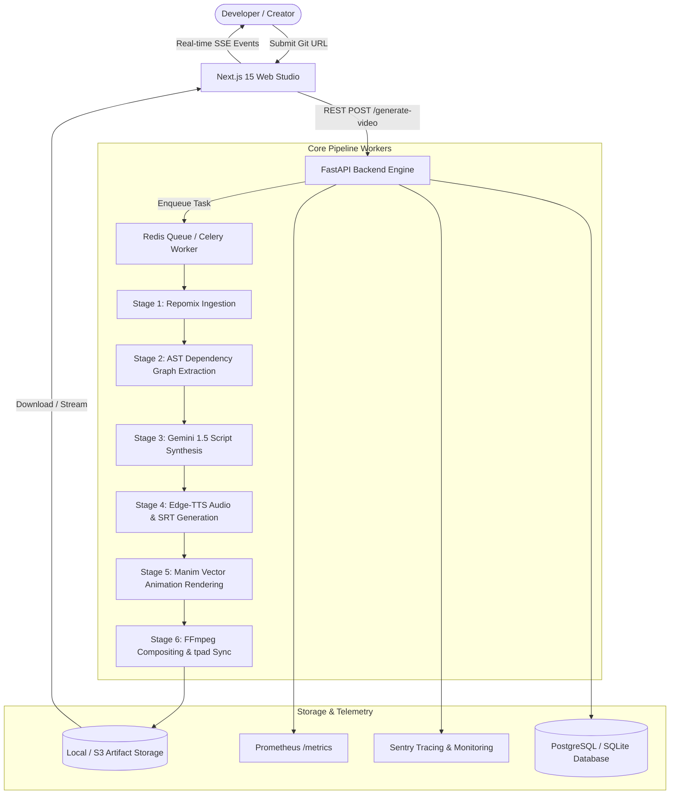

# 🏛️ System Architecture Specification

## Overview

The **Codebase-to-Animated Video Tutorial Engine** is an enterprise-grade autonomous media processing pipeline designed to transform raw source code repositories into broadcast-quality 1080p animated video architecture tutorials.

---

## 1. High-Level Architecture

---

## 2. Pipeline Stages

### Stage 1: Ingestion & Compaction (`ingestion_service.py`)
* Clones public GitHub repositories into isolated sandbox directories.
* Filters out extraneous binary files, lockfiles, node_modules, and git history.
* Employs **Repomix** XML/Markdown packaging to compress codebases while preserving structural context.

### Stage 2: AST Dependency Extraction (`graph_service.py` & `graph_to_manim.py`)
* Performs Abstract Syntax Tree (AST) analysis across Python and TypeScript files.
* Identifies modules, class hierarchies, routing controllers, and inter-package imports.
* Generates a structured JSON dependency graph (`nodes` and `edges`).
* Translates topological nodes into 2D grid coordinates for Manim vector layout.

### Stage 3: Technical Script Synthesis (`gemini_service.py`)
* Directs Google Gemini 1.5 Flash to ingest the structured dependency graph.
* Generates a strict multi-scene technical breakdown:
  1. **Scene 1**: File Tree & Project Structure
  2. **Scene 2**: Architectural Flowchart & Node Connections
  3. **Scene 3**: Core Controller Logic Walkthrough
  4. **Scene 4**: Production Conclusion & Tech Stack Summary
* Directly outputs native script dialogue in the selected target language (e.g., Hindi, Gujarati, Spanish, French).

### Stage 4: Multilingual Neural TTS & Subtitles (`tts_service.py` & `text_cleaner.py`)
* Preprocesses technical identifier tokens (converting `camelCase` and `snake_case` into clean natural language).
* Strips code syntax characters that disrupt speech rhythm.
* Synthesizes audio using native Microsoft Edge-TTS neural models.
* Generates microsecond-accurate SubRip (`.srt`) subtitle tracks.

### Stage 5: Audio-Scaled Manim Rendering (`manim_engine/`)
* Ingests the exact audio duration synthesized in Stage 4.
* Scales animation transitions, box highlights, and text reveals to match speech timing.
* Suppresses trailing fade-out to prevent empty canvas states.
* Renders at 1080p (1920x1080, 30/60 fps) using the Manim Community Cairo renderer.

### Stage 6: Broadcast Composition (`video_composer.py`)
* Merges the Manim visual track and neural voiceover track.
* Applies FFmpeg `tpad=stop_mode=clone` to hold the final visual card smoothly if voiceover extends beyond animation.
* Burns crisp, resolution-scaled subtitles with semi-transparent background badges.
* Encodes high-compatibility H.264 video with AAC audio and FastStart MP4 metadata.

---

## 3. Database & Billing Architecture

* **Idempotent Credit Transactions**: Tracks payments via Stripe Sessions and Binance Pay Order IDs.
* **Binance Pay Integration**: Real-time webhook listener and client polling endpoint (`GET /api/v1/billing/binance/order-status/{order_id}`) for 1 USDT = 1 Video Credit micro-transactions.
* **User Balance Ledger**: Synchronized with PostgreSQL / SQLite `credit_transactions` and `binance_orders` tables.
