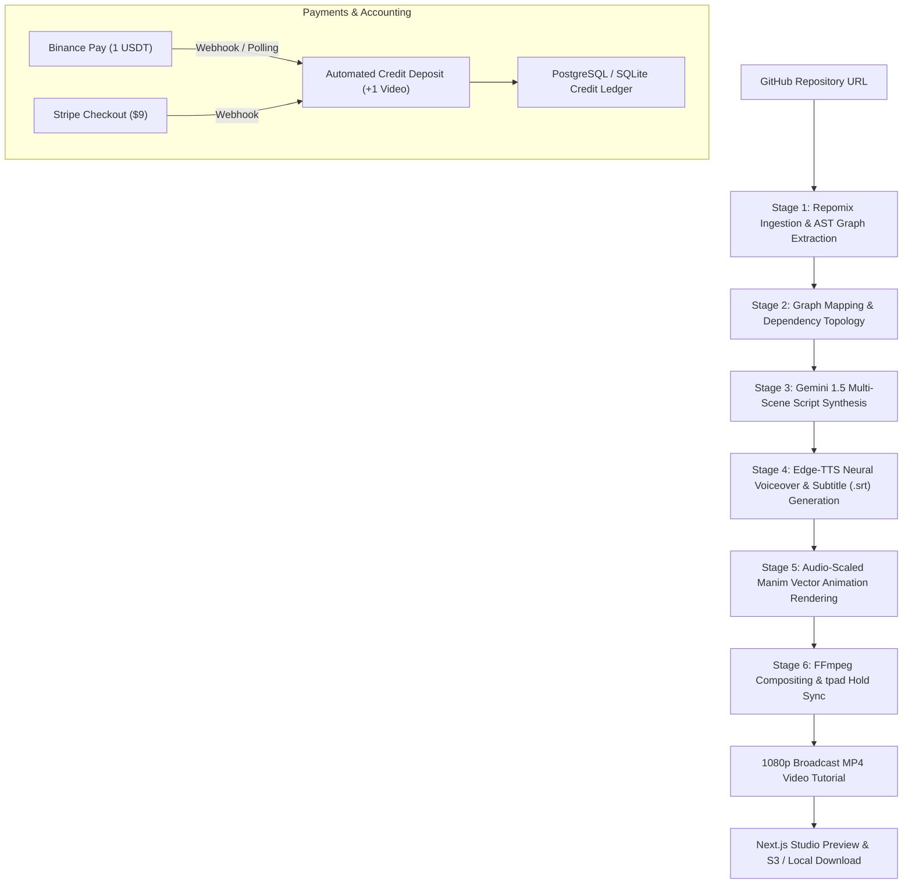

# 🎬 Codebase-to-Animated Video Tutorial Engine

<div align="center">

[](https://opensource.org/licenses/MIT)
[](https://www.python.org/downloads/)
[](https://fastapi.tiangolo.com)
[](https://nextjs.org)
[](https://www.manim.community/)
[](https://www.docker.com/)
[](https://github.com/rajkotpodman/codebase-to-animated-video-tutorial-engine/actions)
[](https://app.binance.com/uni-qr/5HyzYRA1)

**Autonomous AI engine that transforms any public GitHub repository into professional, animated 1080p video architecture tutorials with Manim vector graphics, neural multilingual voiceover, and synchronized subtitles.**

[Features](#-key-features) • [Architecture](#-architecture) • [Quick Start](#-quick-start) • [Binance Pay (1 USDT)](#-pay-with-binance-pay-1-usdt--1-video) • [How to Use](./HOWTOUSE.md) • [API Docs](./API.md)

</div>

---

## 🌟 Overview

The **Codebase-to-Animated Video Tutorial Engine** ingests any public GitHub repository, analyzes its file structure and dependency topology using AST parsing, synthesizes a multi-scene technical breakdown with Google Gemini 1.5, generates beautiful vector animations with the Manim Community engine, records neural text-to-speech voiceovers in 21+ languages, and renders a synchronized broadcast-quality HD MP4 tutorial video.

---

## 🟡 Pay with Binance Pay (1 USDT = 1 Video)

We offer transparent crypto micro-billing: **1 Full HD Codebase Video Tutorial = 1 USDT** on Binance Pay!

When you scan the QR code and send 1 USDT, our automated webhook and real-time polling listener instantly deposits **1 Video Tutorial Credit** into your account.

<div align="center">

### 📱 Scan with Binance App to Pay 1 USDT

<a href="https://app.binance.com/uni-qr/5HyzYRA1">
  
</a>

<br/>

[](https://app.binance.com/uni-qr/5HyzYRA1)

| Detail | Value |
| :--- | :--- |
| **Amount to Send** | `1.00 USDT` |
| **Deposit Reward** | `+1 Video Tutorial Credit` (Full 1080p 60fps video generation) |
| **Direct Payment URL** | [`https://app.binance.com/uni-qr/5HyzYRA1`](https://app.binance.com/uni-qr/5HyzYRA1) |
| **Fulfillment Time** | Real-time automatic credit deposit (typically < 3 seconds) |

</div>

---

## 🚀 Key Features

* **📦 Smart Repomix & AST Ingestion**: Clones target repositories, strips binaries and lockfiles, parses Abstract Syntax Trees (AST) into clean JSON dependency graphs (`nodes` and `edges`).
* **🧠 Gemini 1.5 Flash Technical Synthesis**: Ingests code topology to write comprehensive 4+ scene scripts (File Tree, Architectural Flowchart, Core Logic Walkthrough, Conclusion).
* **🎨 Audio-Scaled Manim Vector Animations**: Manim animation runtime automatically scales to match the exact duration of the voiceover audio, preventing cutoffs or premature black screens.
* **🗣️ 21+ Multilingual Neural Voiceovers**: Native Microsoft Edge-TTS neural voices across Indian languages (Hindi, Gujarati, Marathi, Bengali, Tamil, Telugu, Kannada, Malayalam, Punjabi) and international languages (Spanish, French, German, Japanese, Chinese, Arabic, Russian).
* **📝 Burned-In Subtitle Engine**: Generates microsecond-accurate `.srt` files and burns crisp, resolution-scaled typography directly onto the video stream.
* **🛡️ Zero Black-Screen Guarantee**: Uses FFmpeg `tpad` frame freezing and persistent visual canvas hold, ensuring graphical cards stay pinned smoothly until the final millisecond.
* **💳 Dual Payment Rails**: Crypto via Binance Pay (1 USDT = 1 Video) and fiat via Stripe SaaS billing ($9 Pay-as-you-go & bulk tiers).
* **⚡ Modern Next.js 15 UI**: Dark-themed studio dashboard with real-time SSE progress streaming, video history, interactive architecture studio, and API keys management.

---

## 🏗️ Architecture



---

## ⚡ Quick Start

### 1. Prerequisites
* **Python**: 3.11 or higher
* **Node.js**: 18.0 or higher
* **FFmpeg**: Installed and available in PATH (or bundled via `imageio-ffmpeg`)
* **Cairo / Pango**: Required by Manim for vector rendering

### 2. Clone Repository
```bash
git clone https://github.com/rajkotpodman/codebase-to-animated-video-tutorial-engine.git
cd codebase-to-animated-video-tutorial-engine
```

### 3. Backend Setup
```bash
# 1. Create and activate virtual environment
python -m venv .venv
source .venv/bin/activate  # On Windows: .venv\Scripts\activate

# 2. Install dependencies
pip install -r requirements.txt

# 3. Configure environment variables
cp .env.example .env
# Edit .env and supply GEMINI_API_KEY=your_key_here

# 4. Start FastAPI server
uvicorn app.main:app --host 127.0.0.1 --port 8000 --reload
```
* Interactive API Documentation: [http://127.0.0.1:8000/docs](http://127.0.0.1:8000/docs)
* Health Check: [http://127.0.0.1:8000/health](http://127.0.0.1:8000/health)

### 4. Frontend Setup
```bash
# Open a new terminal in frontend/
cd frontend
npm install
npm run dev
```
* Open [http://localhost:3000](http://localhost:3000) to launch the Codebase2Video Studio.

---

## 🐳 Docker Deployment

Run the complete pipeline with Docker Compose:

```bash
docker compose up -d --build
```
This boots up:
* **FastAPI Backend**: `http://localhost:8000`
* **Next.js Web Studio**: `http://localhost:3000`
* **Redis Cache & Celery Worker Broker**: `localhost:6379`
* **Prometheus Telemetry**: `http://localhost:8000/metrics`

---

## 🌐 Supported Languages (21+)

| Code | Language | Native TTS Voice |
| :--- | :--- | :--- |
| `en` | English | `en-US-GuyNeural` |
| `hi` | Hindi (हिन्दी) | `hi-IN-SwaraNeural` |
| `gu` | Gujarati (ગુજરાતી) | `gu-IN-NiranjanNeural` |
| `mr` | Marathi (मराठी) | `mr-IN-AarohiNeural` |
| `bn` | Bengali (বাংলা) | `bn-IN-BashkarNeural` |
| `ta` | Tamil (தமிழ்) | `ta-IN-PallaviNeural` |
| `te` | Telugu (తెలుగు) | `te-IN-MohanNeural` |
| `kn` | Kannada (ಕನ್ನಡ) | `kn-IN-GaganNeural` |
| `ml` | Malayalam (മലയാളം) | `ml-IN-SobhanaNeural` |
| `pa` | Punjabi (ਪੰਜਾਬੀ) | `pa-IN-OjasNeural` |
| `es` | Spanish | `es-ES-AlvaroNeural` |
| `fr` | French | `fr-FR-HenriNeural` |
| `de` | German | `de-DE-ConradNeural` |
| `ja` | Japanese | `ja-JP-KeitaNeural` |
| `zh` | Chinese (Mandarin) | `zh-CN-YunxiNeural` |
| `ar` | Arabic | `ar-SA-HamedNeural` |

Explore all supported languages dynamically via `GET /api/v1/languages`.

---

## 🧪 Testing

Run the full automated pytest suite:
```bash
pytest tests/test_auth_and_billing.py -v
pytest tests/test_graph_service.py -v
pytest tests/test_multilingual.py -v
```

---

## 📚 Documentation

* [📖 HOW TO USE Guide](./HOWTOUSE.md): Complete setup and step-by-step video generation guide.
* [🏛️ Architecture Specification](./ARCHITECTURE.md): Deep dive into the 6-stage rendering engine.
* [🔌 API Reference](./API.md): Detailed REST endpoints, WebSockets, and webhook schemas.
* [🤝 Contributing](./CONTRIBUTING.md): Guidelines for submitting PRs and code standards.
* [🔒 Security Policy](./SECURITY.md): Vulnerability reporting procedures.
* [📝 Changelog](./CHANGELOG.md): Release notes and version history.

---

## 📄 License

This project is licensed under the [MIT License](./LICENSE) © 2026 rajkotpodman.
